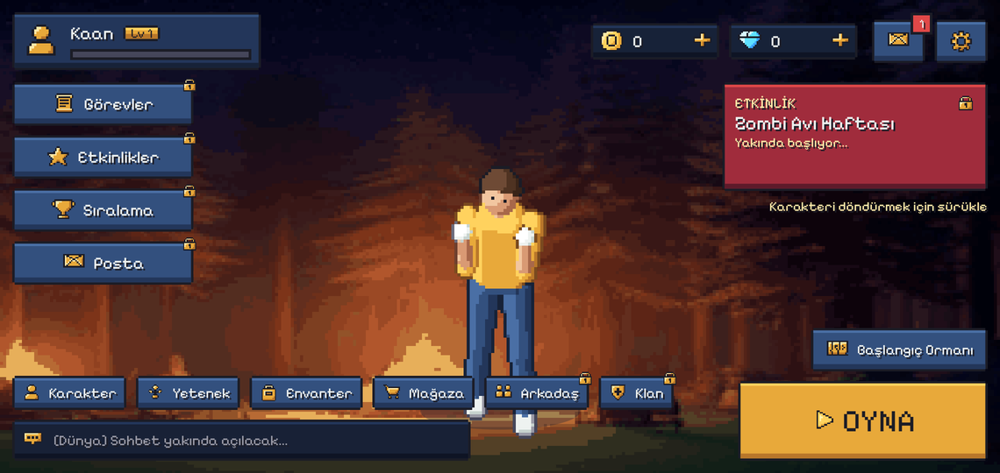
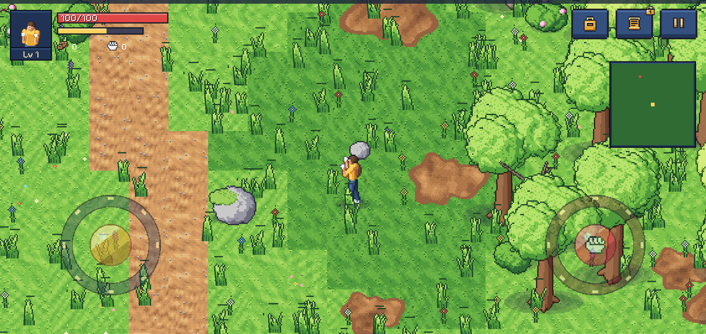
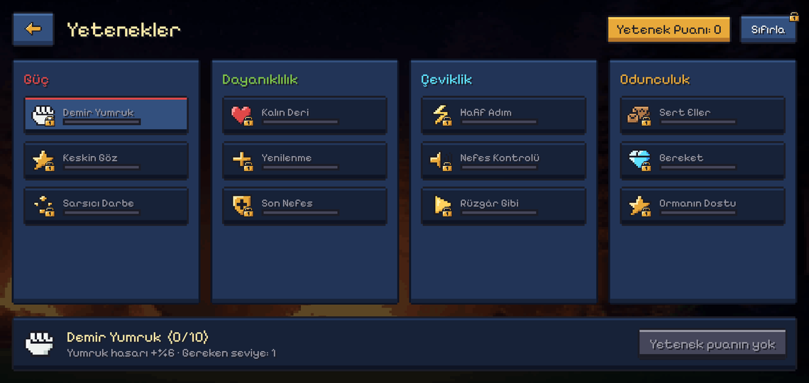
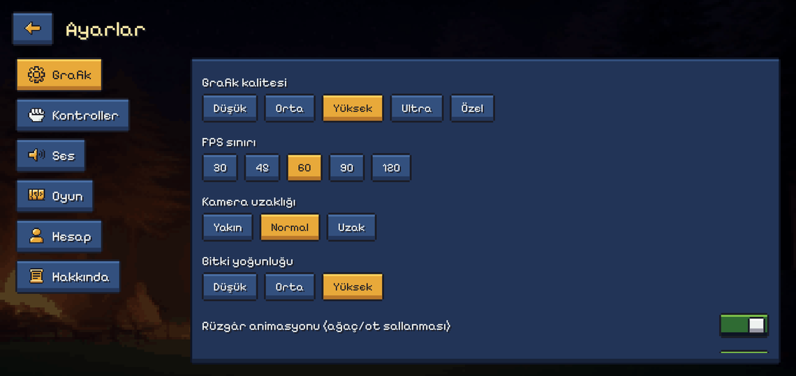

# Zenvex Online

**English** · [Türkçe](README.tr.md) · [Español](README.es.md) · [Português (Brasil)](README.pt-BR.md) · [Русский](README.ru.md) · [Deutsch](README.de.md) · [Français](README.fr.md) · [Italiano](README.it.md) · [Bahasa Indonesia](README.id.md) · [العربية](README.ar.md)

A mobile-first, online 2.5D pixel-art zombie survival game. Gather, craft, fight, join a clan and capture bases.
The game core is written in Rust, the Android app in Kotlin (Jetpack Compose), and online services run on Supabase plus an
optional Rust game server.

> An installable APK is built on every push: GitHub → **Releases** → "Zenvex Online — latest build".

## Screenshots

| Lobby | Game |
|-------|------|
|  |  |
|  |  |

## Repository layout

```
android/            Kotlin app (Compose UI, SurfaceView game view, Play Billing, JNI loader)
rust/zenvex_core    game rules and world: regions, combat, items, quests, economy
rust/zenvex_jni     JNI bridge (libzenvex.so)
rust/zenvex_server  optional WebSocket game server (rooms = regions)
supabase/           SQL migrations and edge functions (accounts, saves, clans, store, support)
deploy/             one-command server install (systemd + Caddy)
tools/              asset pipelines (pixel, assetgen) and tools/i18n (translations)
docs/               design and architecture; docs/archive holds superseded plans
art/                concept art and screenshots
```

## Build

```bash
# Rust: tests and lints (run from rust/)
cargo test --workspace && cargo clippy --workspace --all-targets -- -D warnings

# Android: needs the Android SDK 37, NDK 27 and cargo-ndk
cd android && ./gradlew :app:assembleDebug

# UI snapshot tests (JVM, no emulator)
(cd rust && cargo build -p zenvex_jni --release)
cd android && ./gradlew :app:recordPaparazziDebug -x cargoBuild
```

CI (`.github/workflows`) runs the Rust tests, clippy with warnings as errors, the Kotlin build with warnings as errors and
the snapshot tests, then publishes the APK.

## Languages

The interface ships in Turkish (source), English, Spanish, Portuguese (Brazil), Russian, German, French, Italian,
Indonesian and Arabic. The Turkish text is the translation key; `tools/i18n/extract.py` rebuilds `catalog.json` from the
code and `tools/i18n/merge.py` merges translations into `android/app/src/main/assets/i18n/<lang>.json`.
A unit test fails if any language misses a string or breaks a `{0}` placeholder. See [CONTRIBUTING.md](CONTRIBUTING.md).

## Documents

| Document | Content |
|----------|---------|
| [00 Overview](docs/00_GENEL_BAKIS.md) | vision and scope |
| [04 Architecture](docs/04_TEKNIK_MIMARI.md) | Rust + Kotlin layers, JNI |
| [09 Supabase](docs/09_SUPABASE.md) | database, functions, security model |
| [Game server](docs/teknik/OYUN_SUNUCUSU.md) | WebSocket server and deployment |
| [21 V15 plan](docs/21_BUYUK_PLAN_V15.md) | current roadmap |
| [22 V16 asset and prompt document](docs/22_DEVASA_PROMPT_V16.md) | asset audit, production methods (3D / image / code) and prompts |
| [23 Promo kit](docs/23_TANITIM.md) | key-art prompts and the gameplay trailer pipeline |
| [24 Item icon prompts](docs/24_ESYA_PROMPTLARI.md) | armor sets, necklaces, rings, bags, ammo and chests |
| [25 Shop and VIP art prompts](docs/25_MAGAZA_VIP_PROMPTLARI.md) | VIP badges 1-11, diamond packs, bundles, subscription cards, season tickets, shop background, tab icons |
| [Release guide](docs/teknik/YAYIN.md) | versions, store signing, server, Supabase, store checklist |
| [Tester notes](docs/TEST_NOTLARI.md) | what changed in this test build |

## License and contact

Source code is proprietary unless stated otherwise in a file header; fonts are under the SIL Open Font License
(`android/app/src/main/assets/licenses`). Report security problems privately, see [SECURITY.md](SECURITY.md).
